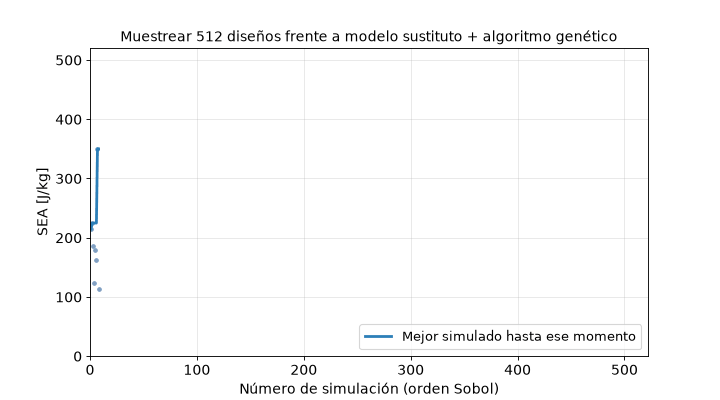
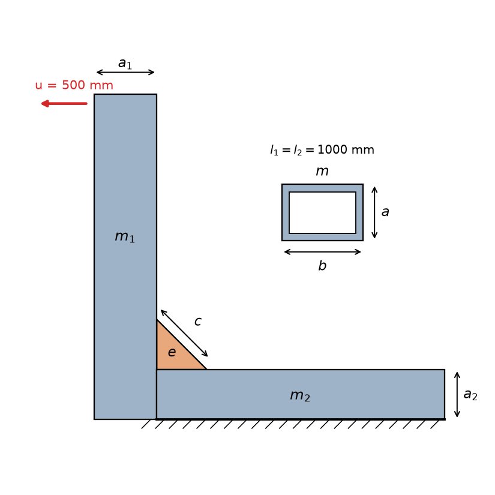
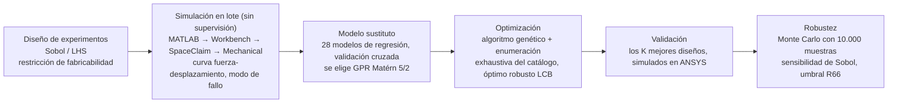
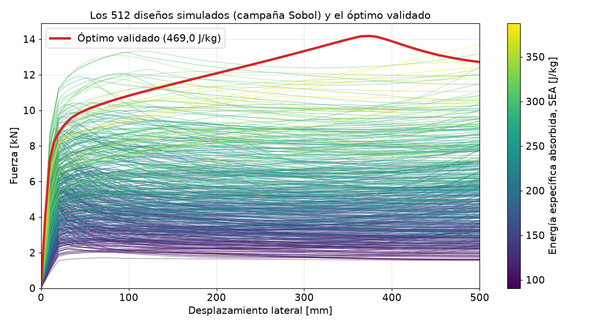
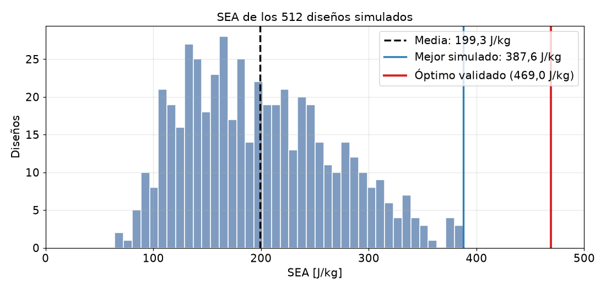
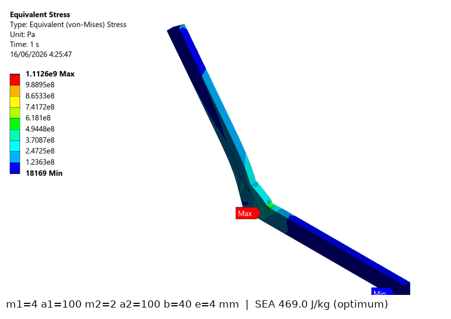
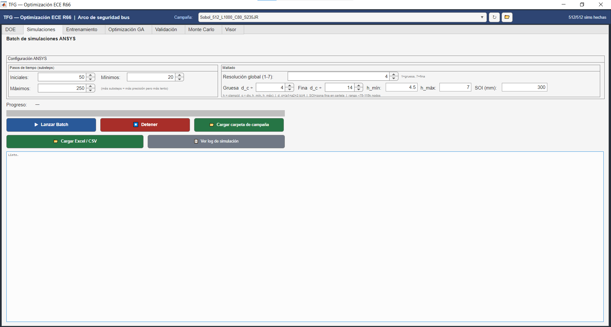

<div align="center">

[English](README.md) · **Español** · [Français](README.fr.md)

# Seguridad antivuelco de autobuses (ECE R66): optimización por elementos finitos de la unión pilar–larguero con un modelo sustituto de procesos gaussianos

[](https://www.mathworks.com/products/matlab.html)
[](https://www.ansys.com/)
[](https://www.python.org/)
[](https://es.wikipedia.org/wiki/Kriging)
[](https://unece.org/transport/vehicle-regulations)
[](LICENSE)

Trabajo Fin de Grado · ETSII, Universidad Politécnica de Madrid · Pablo Turrado Vega · 2026



*Cada punto es una simulación no lineal por elementos finitos (en el orden de la secuencia de Sobol). El mejor de los 512 diseños simulados llega a 387,6 J/kg; el diseño que propone el modelo sustituto con el algoritmo genético, simulado después en ANSYS, absorbe **469,0 J/kg**.*

</div>

---

## En un párrafo

En un vuelco, la superestructura del autobús tiene que absorber la energía liberada sin invadir el espacio de supervivencia de los pasajeros (Reglamento ECE R66). Cada sección candidata exige un análisis por elementos finitos no lineal, con grandes deformaciones, que tarda **entre 20 y 90 minutos**, así que no se puede probar todo. Este proyecto monta un flujo automático completo: MATLAB controla **ANSYS Workbench, SpaceClaim y Mechanical** en lote y sin supervisión (**1.340 simulaciones y más de 400 horas de cálculo**), un **modelo sustituto de procesos gaussianos (GPR, Matérn 5/2)** aprende la energía absorbida a partir de las simulaciones, y un **algoritmo genético con enumeración exhaustiva del catálogo comercial** (perfiles huecos EN 10210-2) encuentra la unión que más energía absorbe por kilo. El óptimo se valida en ANSYS, se comprueba frente a las tolerancias de fabricación con Monte Carlo y frente al umbral de energía del R66. Una interfaz gráfica en MATLAB reúne todo el flujo.

## Resultados principales

| | Valor | Nota |
|---|---|---|
| Simulaciones por elementos finitos | **1.340** en 5 campañas | LHS-60, Sobol-512 (c = 80 mm), Sobol-512 con cartela variable (7 variables), S275JR-128, S355JR-128 |
| Mejor modelo sustituto (28 comparados, validación cruzada de 5 particiones) | **GPR Matérn 5/2** | R²-CV = 0,987, RMSE-CV = 132,6 J (2,4 % del rango de energía) |
| Óptimo validado (S235JR, c = 80 mm) | **469,0 J/kg** | predicho 457,7 J/kg: error del 2,4 %, del lado conservador |
| Mejora sobre el espacio de diseño | **+135 %** frente a la media de los 512 diseños (199,3 J/kg) | **+21 %** frente al mejor diseño realmente simulado (387,6 J/kg, simulación 167) |
| Cartela mayor (c hasta 120 mm) | **537,5–541,2 J/kg** validados | en torno a un 15 % más que el óptimo con c = 80 mm |
| Robustez (10.000 muestras de Monte Carlo, tolerancias EN 10210-2) | coeficiente de variación del **0,85 %** | probabilidad de quedar por debajo del umbral del R66 (285,2 J/kg): **0 %** |
| Espacio de búsqueda | 19.683 diseños de catálogo (216.513 con cartela variable) | la enumeración exhaustiva confirma el óptimo del algoritmo genético |

Geometría óptima (S235JR): pilar de 100 × 40 × 4 mm, larguero de 100 × 40 × 2 mm, cartela de 4 mm de espesor con catetos de 80 mm. **La misma geometría es la óptima con S275JR y S355JR** (validadas en 527,1 y 642,5 J/kg).

## El problema



La estructura es la **unión pilar–larguero (sección en L)** del arco de seguridad de un autobús: dos tubos rectangulares unidos en ángulo recto y reforzados con una cartela triangular. La base del larguero está empotrada y el extremo del pilar se desplaza **500 mm** lateralmente (cuasiestático, unos 30° de giro).

Variables de diseño (mm):
- **m₁, a₁**: espesor de pared y lado (en el plano de flexión) del pilar
- **m₂, a₂**: espesor de pared y lado del larguero
- **b**: ancho de los dos tubos (perpendicular al plano)
- **e**: espesor de la cartela; **c**: cateto de la cartela (80 mm, o de 70 a 120 mm en la campaña de 7 variables)

Fabricabilidad (perfiles huecos laminados en caliente, EN 10210-2): m ≤ mín(a, b)/4.

**Objetivo: energía específica absorbida**, SEA = E / masa [J/kg], donde E es el área bajo la curva fuerza-desplazamiento hasta 500 mm y la masa se calcula de forma analítica (`masa_analitica.m`).

<br clear="right">

## Flujo de trabajo



Los pasos se pasan ficheros (`basededatos.csv`, `Sim_NNN/Curvas.csv`, `modelo_surrogate.mat`, …) dentro de `Resultados/<campaña>/`, así que un lote se puede interrumpir y reanudar en cualquier momento.

## Los resultados en imágenes



*Curvas fuerza-desplazamiento de los 512 diseños Sobol, coloreadas por su SEA, y el óptimo validado (en rojo).*



<table>
<tr>
<td width="55%"></td>
<td>

**Geometrías distintas, colapsos distintos.** Tensión de von Mises al final del desplazamiento de 500 mm (capturas de ANSYS) en el óptimo y en cuatro diseños de la campaña principal, con sus dimensiones y su SEA. La zona que plastifica (el pilar sobre la cartela, el extremo de la cartela, el larguero) cambia con la geometría.

</td>
</tr>
</table>

**Qué decide la energía (índices de Sobol sobre el modelo sustituto).** Manda el pilar: su espesor (S_T = 0,516) y su lado (S_T = 0,390) explican la mayor parte de la varianza; el espesor de la cartela apenas influye (S_T = 0,008), así que su tolerancia se puede relajar. Figura: [`figura_sensibilidad_sobol.png`](Resultados/Sobol_512_L1000_C80_S235JR/figura_sensibilidad_sobol.png).

**Muestreo.** Sobol cubre el espacio de forma más uniforme que LHS (discrepancia L2-estrella de 0,0101 frente a 0,0117 con 60 puntos; correlaciones espurias de 0,142 frente a 0,159, que bajan a 0,011 con 512 puntos). Gracias a su extensibilidad, la curva de convergencia sale gratis de los prefijos anidados: el RMSE-CV baja de 316 J (64 muestras) a 139 J (512), un 56 %. Figura: [`convergencia_rmse_sobol512.png`](Resultados/Sobol_512_L1000_C80_S235JR/convergencia_rmse_sobol512.png).

**Calidad del acero.** En 128 geometrías pareadas, la SEA escala casi por igual en todas: ×1,105 con S275JR y ×1,319 con S355JR, menos que lo que sube el límite elástico (+16,8 % y +50,7 %).

**¿Un modelo o uno por modo de fallo?** Los modelos especializados por modo de colapso predicen mejor *dentro* de su modo, pero llevan al optimizador a esquinas del catálogo donde sobreestiman: el óptimo del modelo especializado se validó en 445,1 J/kg (predicho 506,9, un 14 % por encima) frente a los 469,0 J/kg del modelo global, con el triple de simulaciones. El modelo global gana donde importa.

**Cumplimiento del R66.** Figura: [`figura_ecr66_cumplimiento.png`](Resultados/Sobol_512_L1000_C80_S235JR/figura_ecr66_cumplimiento.png).

## La interfaz gráfica (`TFG_GUI.m`)



Una sola aplicación de MATLAB (`classdef`, unas 5.700 líneas) ejecuta todo el flujo sin tocar el código: diseño de experimentos con límites, valores fijos y variables vinculadas; lanzamiento del lote con controles de malla y subpasos; entrenamiento de hasta 28 modelos; optimización con algoritmo genético y fuerza bruta con el umbral del R66; validación en ANSYS de los K mejores; Monte Carlo y sensibilidad de Sobol; y un visor de cada simulación (curvas, tensiones, vistas). El selector de campaña cambia datos, modelos y registros.

## Estructura del repositorio

```text
├── TFG_GUI.m                        interfaz gráfica (todo el flujo)
├── T01_Generar_DOE_Sobol.m          1. diseño de experimentos (Sobol)   · T01_Generar_DOE_LHS.m (LHS)
├── T02_Lanzar_Simulaciones_Batch.m  2. lote de ANSYS sin supervisión (reanudable)
├── T03_Entrenar_Modelo_IA.m         3. limpieza de datos + entrenamiento del modelo sustituto
├── T04_Optimizacion_GA.m            4. algoritmo genético + enumeración del catálogo
├── T05_Validar_Optimo.m             5. validación en ANSYS de los K mejores
├── T06_Analisis_Montecarlo.m        6. robustez con Monte Carlo y cumplimiento del R66
├── masa_analitica.m · calcular_pivot.m · extraer_gpr.m · analizar_sensibilidad_sobol.m
├── journal_workbench.wbjn · plantilla_spaceclaim.py · macro_mechanical.py   automatización de ANSYS
├── recalcular_modos_fallo.m · regenerar_graficas.m                         mantenimiento
├── active_campaign.txt              puntero a la campaña activa
├── docs/                            figuras del README (las regenera make_figures.py)
└── Resultados/                      una carpeta por campaña: basededatos.csv, modelos, figuras, Sim_NNN/
    ├── DOE_60_L1000_C80_S235JR/            piloto LHS
    ├── Sobol_512_L1000_C80_S235JR/         campaña principal (6 variables)
    ├── Sobol_512_L1000_Cvar_S235JR/        cartela variable (7 variables)
    ├── Sobol_128_L1000_C80_S275JR/  ·  Sobol_128_L1000_C80_S355JR/   calidades de acero
    └── Comp_IA0_128mix_… · Comp_IAc_128cart_…   modelo global frente a especializado
```

## Inicio rápido

Requisitos: MATLAB (desarrollado con R2025a) con las toolboxes Statistics and Machine Learning y Global Optimization. ANSYS Workbench/Mechanical (se detectan de la 2021 R1 a la 2025 R2) solo hace falta para lanzar simulaciones nuevas: la interfaz, los modelos ya entrenados y los análisis funcionan sin él.

```matlab
TFG_GUI                         % todo el flujo en una ventana
% o paso a paso:
T01_Generar_DOE_Sobol           % 1. plan de muestreo        → basededatos.csv
T02_Lanzar_Simulaciones_Batch   % 2. lote en ANSYS           → Sim_NNN/Curvas.csv
T03_Entrenar_Modelo_IA          % 3. modelo sustituto        → modelo_surrogate.mat
T04_Optimizacion_GA             % 4. optimización            → optimo_GA.mat
T05_Validar_Optimo              % 5. validación en ANSYS
T06_Analisis_Montecarlo         % 6. robustez y cumplimiento del R66
```

Para regenerar las figuras del README: `python docs/make_figures.py` (numpy, pandas, matplotlib, pillow).

## Limitaciones y notas sobre los datos

- Una sola unión con carga monotónica cuasiestática, acero S235JR bilineal y un elemento en el espesor de la pared; el modelo está verificado con el refinamiento de malla, no con ensayos.
- La etiqueta de modo de fallo (`calcular_pivot.m`) usa la altura del único nodo de máxima tensión de von Mises: describe el mecanismo de colapso de forma aproximada.
- En la campaña de cartela variable, `Sim_040` (se para a 26 mm) y `Sim_453` (se para a 250 mm) figuran como válidas aunque no llegaron a 500 mm; su efecto en el modelo sustituto es despreciable. Las carpetas de validación `Sim_VAL_Cat_9` (c = 80 mm) y `Sim_VAL_Cat_5` (cartela variable) contienen la curva de otro diseño.

Siguiente paso natural: muestreo adaptativo (bayesiano) en lugar de un diseño de experimentos de una sola vez, que la memoria propone como línea futura.

## Cómo citarlo

```bibtex
@thesis{TurradoVega2026TFG,
  author = {Pablo Turrado Vega},
  title  = {Optimización de secciones estructurales para arcos de seguridad antivuelco de autobús (ECE R66) mediante modelos sustitutos y algoritmos genéticos},
  school = {Escuela Técnica Superior de Ingenieros Industriales, Universidad Politécnica de Madrid},
  type   = {Trabajo Fin de Grado},
  year   = {2026},
  address = {Madrid, España}
}
```

## Licencia

MIT. Ver [`LICENSE`](LICENSE).
