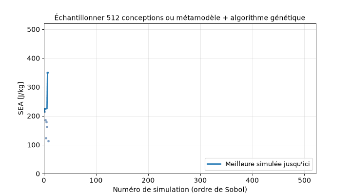
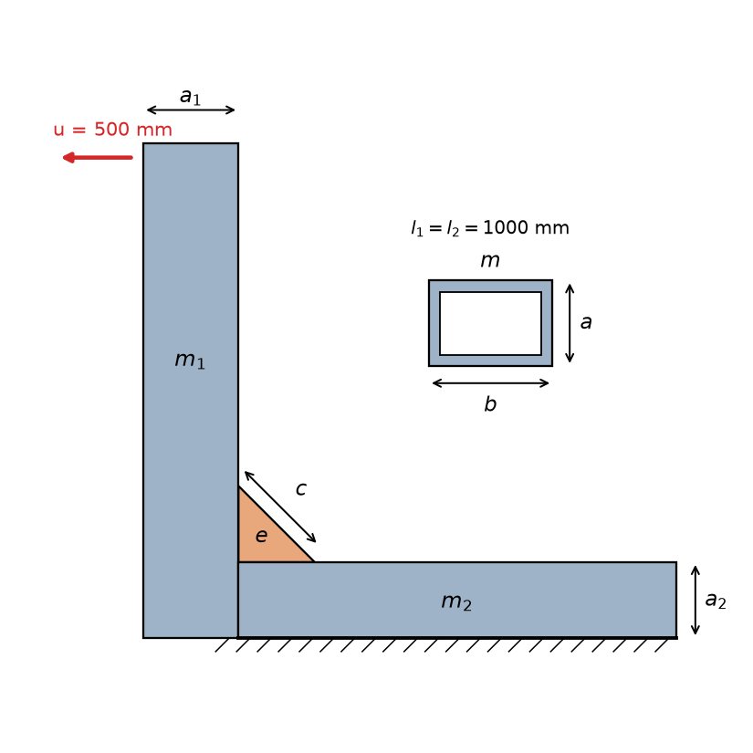
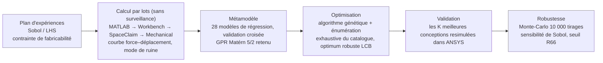
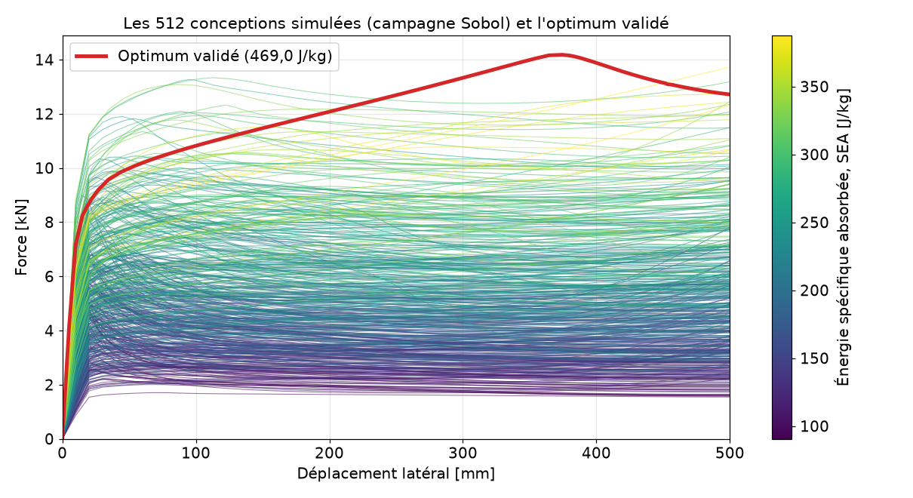
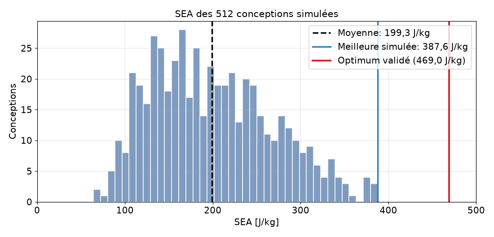
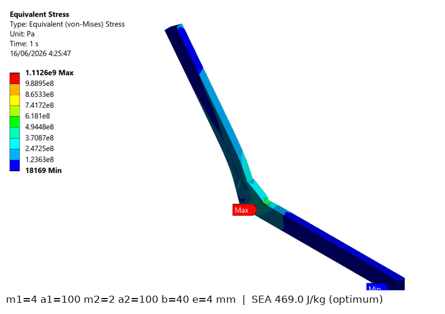
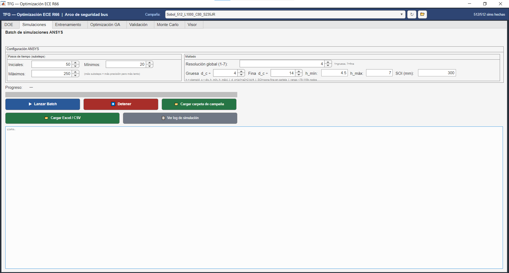

<div align="center">

[English](README.md) · [Español](README.es.md) · **Français**

# Sécurité au retournement des autocars (ECE R66) : optimisation par éléments finis d'un assemblage montant–traverse avec un métamodèle à processus gaussiens

[](https://www.mathworks.com/products/matlab.html)
[](https://www.ansys.com/)
[](https://www.python.org/)
[](https://fr.wikipedia.org/wiki/Krigeage)
[](https://unece.org/transport/vehicle-regulations)
[](LICENSE)

Projet de fin d'études de licence (TFG) · ETSII, Universidad Politécnica de Madrid · Pablo Turrado Vega · 2026



*Chaque point est une simulation par éléments finis non linéaire (dans l'ordre de la suite de Sobol). La meilleure des 512 conceptions simulées atteint 387,6 J/kg ; la conception proposée par le métamodèle et l'algorithme génétique, simulée ensuite dans ANSYS, absorbe **469,0 J/kg**.*

</div>

---

## En un paragraphe

Lors d'un retournement, la superstructure d'un autocar doit absorber l'énergie libérée sans envahir l'espace de survie des passagers (Règlement ECE R66). Chaque section candidate demande une analyse par éléments finis non linéaire, en grandes déformations, qui dure **de 20 à 90 minutes** : impossible de tout essayer. Ce projet met en place une chaîne entièrement automatisée : MATLAB pilote **ANSYS Workbench, SpaceClaim et Mechanical** en traitement par lots sans surveillance (**1 340 simulations, plus de 400 heures de calcul**), un **métamodèle à processus gaussiens (GPR, Matérn 5/2)** apprend l'énergie absorbée à partir des simulations, et un **algorithme génétique avec énumération exhaustive du catalogue commercial** (profils creux EN 10210-2) trouve l'assemblage qui absorbe le plus d'énergie par kilogramme. L'optimum est validé dans ANSYS, vérifié vis-à-vis des tolérances de fabrication par Monte-Carlo et du seuil d'énergie du R66. Une interface graphique MATLAB regroupe toute la chaîne.

## Résultats principaux

| | Valeur | Remarque |
|---|---|---|
| Simulations par éléments finis | **1 340** en 5 campagnes | LHS-60, Sobol-512 (c = 80 mm), Sobol-512 à gousset variable (7 variables), S275JR-128, S355JR-128 |
| Meilleur métamodèle (28 comparés, validation croisée à 5 blocs) | **GPR Matérn 5/2** | R²-CV = 0,987, RMSE-CV = 132,6 J (2,4 % de la plage d'énergie) |
| Optimum validé (S235JR, c = 80 mm) | **469,0 J/kg** | prédit 457,7 J/kg : erreur de 2,4 %, du côté conservateur |
| Gain sur l'espace de conception | **+135 %** par rapport à la moyenne des 512 conceptions (199,3 J/kg) | **+21 %** par rapport à la meilleure conception réellement simulée (387,6 J/kg, simulation 167) |
| Gousset plus grand (c jusqu'à 120 mm) | **537,5–541,2 J/kg** validés | environ 15 % de plus que l'optimum à c = 80 mm |
| Robustesse (10 000 tirages de Monte-Carlo, tolérances EN 10210-2) | coefficient de variation **0,85 %** | probabilité de passer sous le seuil R66 (285,2 J/kg) : **0 %** |
| Espace de recherche | 19 683 conceptions du catalogue (216 513 avec gousset variable) | l'énumération exhaustive confirme l'optimum de l'algorithme génétique |

Géométrie optimale (S235JR) : montant 100 × 40 × 4 mm, traverse 100 × 40 × 2 mm, gousset de 4 mm d'épaisseur avec des côtés de 80 mm. **La même géométrie est optimale en S275JR et S355JR** (validées à 527,1 et 642,5 J/kg).

## Le problème



La structure est l'**assemblage montant–traverse (section en L)** de l'arceau de sécurité d'un autocar : deux tubes rectangulaires assemblés à angle droit et renforcés par un gousset triangulaire. La base de la traverse est encastrée et le sommet du montant est déplacé latéralement de **500 mm** (quasi statique, environ 30° de rotation).

Variables de conception (mm) :
- **m₁, a₁** : épaisseur de paroi et côté (dans le plan de flexion) du montant
- **m₂, a₂** : épaisseur de paroi et côté de la traverse
- **b** : largeur des deux tubes (hors plan)
- **e** : épaisseur du gousset ; **c** : côté du gousset (80 mm, ou de 70 à 120 mm dans la campagne à 7 variables)

Fabricabilité (profils creux finis à chaud, EN 10210-2) : m ≤ min(a, b)/4.

**Objectif : énergie spécifique absorbée**, SEA = E / masse [J/kg], où E est l'aire sous la courbe force–déplacement jusqu'à 500 mm et la masse est calculée analytiquement (`masa_analitica.m`).

<br clear="right">

## Chaîne de calcul



Les étapes s'échangent des fichiers (`basededatos.csv`, `Sim_NNN/Curvas.csv`, `modelo_surrogate.mat`, …) dans `Resultados/<campagne>/` : un lot peut être interrompu et repris à tout moment.

## Les résultats en images



*Courbes force–déplacement des 512 conceptions de Sobol, colorées par leur SEA, et l'optimum validé (en rouge).*



<table>
<tr>
<td width="55%"></td>
<td>

**Géométries différentes, ruines différentes.** Contrainte de von Mises en fin de déplacement de 500 mm (captures d'ANSYS) pour l'optimum et quatre conceptions de la campagne principale, avec leurs dimensions et leur SEA. La zone qui plastifie (montant au-dessus du gousset, pointe du gousset, traverse) change avec la géométrie.

</td>
</tr>
</table>

**Ce qui pilote l'énergie (indices de Sobol sur le métamodèle).** Le montant domine : son épaisseur (S_T = 0,516) et son côté (S_T = 0,390) expliquent l'essentiel de la variance ; l'épaisseur du gousset n'a presque aucun effet (S_T = 0,008), sa tolérance peut donc être relâchée. Figure (en espagnol) : [`figura_sensibilidad_sobol.png`](Resultados/Sobol_512_L1000_C80_S235JR/figura_sensibilidad_sobol.png).

**Échantillonnage.** Sobol couvre l'espace plus uniformément que LHS (discrépance L2-étoile 0,0101 contre 0,0117 avec 60 points ; corrélations parasites 0,142 contre 0,159, qui tombent à 0,011 avec 512 points). Grâce à son extensibilité, la courbe de convergence s'obtient gratuitement à partir des préfixes emboîtés : la RMSE-CV passe de 316 J (64 échantillons) à 139 J (512), soit −56 %. Figure : [`convergencia_rmse_sobol512.png`](Resultados/Sobol_512_L1000_C80_S235JR/convergencia_rmse_sobol512.png).

**Nuance d'acier.** Sur 128 géométries appariées, la SEA augmente de façon presque uniforme avec la nuance : ×1,105 en S275JR et ×1,319 en S355JR, moins que la hausse de la limite d'élasticité (+16,8 % et +50,7 %).

**Un modèle ou un par mode de ruine ?** Des métamodèles spécialisés par mode de ruine prédisent mieux *à l'intérieur* de leur mode, mais poussent l'optimiseur vers des coins du catalogue où ils surestiment : l'optimum du modèle spécialisé a été validé à 445,1 J/kg (prédit 506,9, soit 14 % de trop) contre 469,0 J/kg pour le modèle global, avec trois fois plus de simulations. Le modèle global gagne là où cela compte.

**Conformité R66.** Figure (en espagnol) : [`figura_ecr66_cumplimiento.png`](Resultados/Sobol_512_L1000_C80_S235JR/figura_ecr66_cumplimiento.png).

## L'interface graphique (`TFG_GUI.m`)



Une seule application MATLAB (`classdef`, environ 5 700 lignes) exécute toute la chaîne sans toucher au code : plan d'expériences avec bornes, valeurs fixées et variables liées ; lancement des lots avec réglages de maillage et de sous-pas ; entraînement de jusqu'à 28 modèles ; optimisation par algorithme génétique et force brute avec le seuil R66 ; validation des K meilleures conceptions dans ANSYS ; Monte-Carlo et sensibilité de Sobol ; et une visionneuse de chaque simulation (courbes, contraintes, vues). Le sélecteur de campagne change les données, les modèles et les journaux.

## Organisation du dépôt

```text
├── TFG_GUI.m                        interface graphique (toute la chaîne)
├── T01_Generar_DOE_Sobol.m          1. plan d'expériences (Sobol)   · T01_Generar_DOE_LHS.m (LHS)
├── T02_Lanzar_Simulaciones_Batch.m  2. lot ANSYS sans surveillance (reprise possible)
├── T03_Entrenar_Modelo_IA.m         3. nettoyage des données + entraînement du métamodèle
├── T04_Optimizacion_GA.m            4. algorithme génétique + énumération du catalogue
├── T05_Validar_Optimo.m             5. validation des K meilleures dans ANSYS
├── T06_Analisis_Montecarlo.m        6. robustesse par Monte-Carlo et conformité R66
├── masa_analitica.m · calcular_pivot.m · extraer_gpr.m · analizar_sensibilidad_sobol.m
├── journal_workbench.wbjn · plantilla_spaceclaim.py · macro_mechanical.py   automatisation d'ANSYS
├── recalcular_modos_fallo.m · regenerar_graficas.m                         maintenance
├── active_campaign.txt              pointeur vers la campagne active
├── docs/                            figures du README (régénérées par make_figures.py)
└── Resultados/                      un dossier par campagne : basededatos.csv, modèles, figures, Sim_NNN/
    ├── DOE_60_L1000_C80_S235JR/            pilote LHS
    ├── Sobol_512_L1000_C80_S235JR/         campagne principale (6 variables)
    ├── Sobol_512_L1000_Cvar_S235JR/        gousset variable (7 variables)
    ├── Sobol_128_L1000_C80_S275JR/  ·  Sobol_128_L1000_C80_S355JR/   nuances d'acier
    └── Comp_IA0_128mix_… · Comp_IAc_128cart_…   modèle global ou spécialisé
```

Les identifiants, commentaires et colonnes CSV du code sont en espagnol.

## Démarrage rapide

Prérequis : MATLAB (développé avec R2025a) avec les toolboxes Statistics and Machine Learning et Global Optimization. ANSYS Workbench/Mechanical (versions 2021 R1 à 2025 R2 détectées) n'est nécessaire que pour lancer de nouvelles simulations : l'interface, les métamodèles entraînés et les analyses fonctionnent sans lui.

```matlab
TFG_GUI                         % toute la chaîne dans une fenêtre
% ou étape par étape :
T01_Generar_DOE_Sobol           % 1. plan d'échantillonnage  → basededatos.csv
T02_Lanzar_Simulaciones_Batch   % 2. lot dans ANSYS          → Sim_NNN/Curvas.csv
T03_Entrenar_Modelo_IA          % 3. métamodèle              → modelo_surrogate.mat
T04_Optimizacion_GA             % 4. optimisation            → optimo_GA.mat
T05_Validar_Optimo              % 5. validation dans ANSYS
T06_Analisis_Montecarlo         % 6. robustesse et conformité R66
```

Pour régénérer les figures du README : `python docs/make_figures.py` (numpy, pandas, matplotlib, pillow).

## Limites et remarques sur les données

- Un seul assemblage sous chargement monotone quasi statique, acier S235JR bilinéaire, un élément dans l'épaisseur de paroi ; le modèle est vérifié par raffinement du maillage, pas par des essais.
- L'étiquette de mode de ruine (`calcular_pivot.m`) utilise la hauteur du seul nœud de contrainte de von Mises maximale : c'est un descripteur grossier du mécanisme de ruine.
- Dans la campagne à gousset variable, `Sim_040` (arrêtée à 26 mm) et `Sim_453` (arrêtée à 250 mm) sont marquées valides alors qu'elles n'ont pas atteint 500 mm ; leur effet sur le métamodèle est négligeable. Les dossiers de validation `Sim_VAL_Cat_9` (c = 80 mm) et `Sim_VAL_Cat_5` (gousset variable) contiennent la courbe d'une autre conception.

Prochaine étape naturelle : un échantillonnage adaptatif (bayésien) au lieu d'un plan d'expériences en une seule fois, que le mémoire propose comme perspective.

## Citation

```bibtex
@thesis{TurradoVega2026TFG,
  author = {Pablo Turrado Vega},
  title  = {Optimización de secciones estructurales para arcos de seguridad antivuelco de autobús (ECE R66) mediante modelos sustitutos y algoritmos genéticos},
  school = {Escuela Técnica Superior de Ingenieros Industriales, Universidad Politécnica de Madrid},
  type   = {Projet de fin d'études de licence (Trabajo Fin de Grado)},
  year   = {2026},
  address = {Madrid, Espagne}
}
```

## Licence

MIT. Voir [`LICENSE`](LICENSE).
