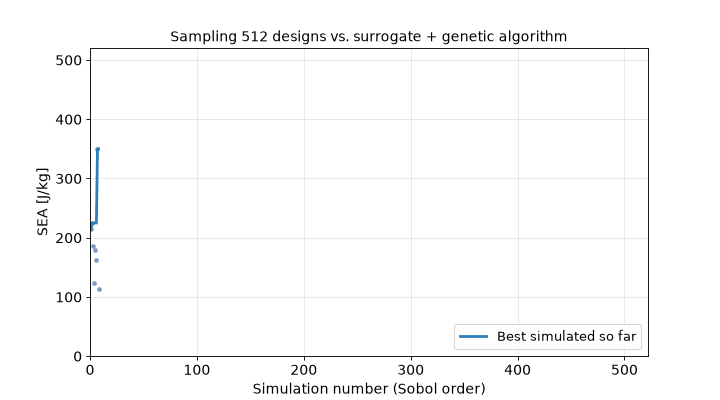
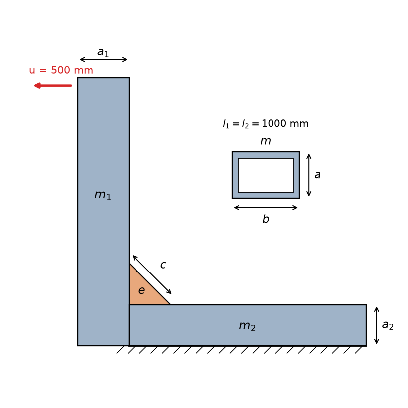
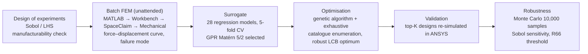
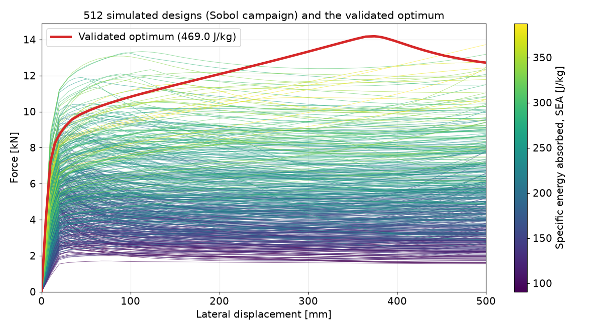
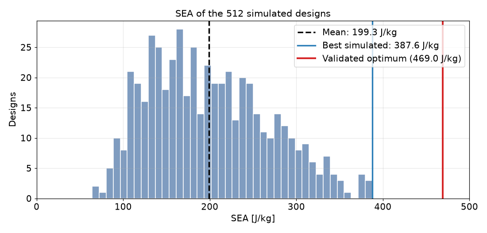
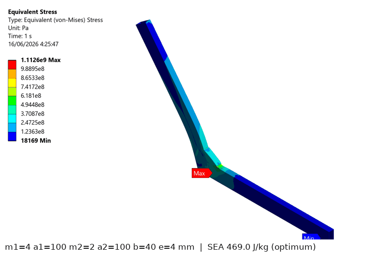
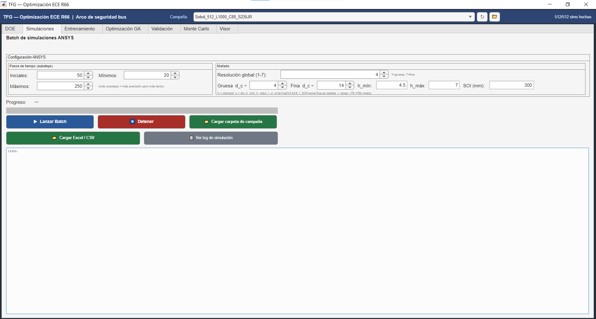

<div align="center">

**English** · [Español](README.es.md) · [Français](README.fr.md)

# Bus rollover safety (UN ECE R66): FEM-driven optimisation of a pillar–beam joint with a Gaussian-process surrogate

[](https://www.mathworks.com/products/matlab.html)
[](https://www.ansys.com/)
[](https://www.python.org/)
[](https://en.wikipedia.org/wiki/Kriging)
[](https://unece.org/transport/vehicle-regulations)
[](LICENSE)

Bachelor's thesis (TFG) · ETSII, Universidad Politécnica de Madrid · Pablo Turrado Vega · 2026



*Each dot is one non-linear FEM simulation (Sobol order). The best of the 512 simulated designs reaches 387.6 J/kg; the design proposed by the surrogate + genetic algorithm, re-simulated in ANSYS, absorbs **469.0 J/kg**.*

</div>

---

## In one paragraph

In a rollover, a bus superstructure must absorb the released energy without intruding into the passengers' survival space (UN ECE R66). Each candidate section needs a non-linear, large-deformation FEM analysis that takes **20 to 90 minutes**, so exhaustive search is out of reach. This project builds a fully automated pipeline: MATLAB drives **ANSYS Workbench, SpaceClaim and Mechanical** in unattended batch mode (**1,340 simulations, more than 400 hours of computing**), a **Gaussian-process (GPR, Matérn 5/2) surrogate** learns the absorbed energy from the simulations, and a **genetic algorithm plus exhaustive enumeration of the commercial catalogue** (EN 10210-2 hollow sections) finds the lightest, most energy-absorbing joint. The optimum is validated in ANSYS, checked for manufacturing tolerances with Monte Carlo, and checked against the R66 energy threshold. A MATLAB GUI wraps the whole workflow.

## Key results

| | Value | Note |
|---|---|---|
| FEM simulations | **1,340** in 5 campaigns | LHS-60, Sobol-512 (c = 80 mm), Sobol-512 with variable gusset (7 variables), S275JR-128, S355JR-128 |
| Best surrogate (28 models compared, 5-fold CV) | **GPR Matérn 5/2** | R²-CV = 0.987, RMSE-CV = 132.6 J (2.4 % of the energy range) |
| Validated optimum (S235JR, c = 80 mm) | **469.0 J/kg** | predicted 457.7 J/kg: 2.4 % error, on the conservative side |
| Gain over the design space | **+135 %** vs the mean of the 512 designs (199.3 J/kg) | **+21 %** vs the best design actually simulated (387.6 J/kg, simulation 167) |
| Larger gusset (c up to 120 mm) | **537.5–541.2 J/kg** validated | about +15 % over the c = 80 mm optimum |
| Robustness (10,000 Monte Carlo samples, EN 10210-2 tolerances) | coefficient of variation **0.85 %** | probability of falling below the R66 threshold (285.2 J/kg): **0 %** |
| Search space | 19,683 catalogue designs (216,513 with variable gusset) | exhaustive enumeration confirms the GA optimum |

Optimal geometry (S235JR): pillar 100 × 40 × 4 mm, beam 100 × 40 × 2 mm, gusset 4 mm thick with 80 mm legs. The **same geometry is optimal for S275JR and S355JR** (validated 527.1 and 642.5 J/kg).

## The problem



The structure is the critical **pillar–beam joint (L-section)** of a bus safety ring: two rectangular hollow tubes joined at a right angle and stiffened by a triangular gusset. The base of the beam is clamped and the top of the pillar is pushed **500 mm sideways** (quasi-static, ≈ 30° of rotation).

Design variables (mm):
- **m₁, a₁**: wall thickness and side (in the bending plane) of the pillar
- **m₂, a₂**: wall thickness and side of the beam
- **b**: width of both tubes (out of plane)
- **e**: gusset thickness; **c**: gusset leg (80 mm, or 70–120 mm in the 7-variable campaign)

Manufacturability (hot-finished hollow sections, EN 10210-2): m ≤ min(a, b)/4.

**Objective: specific energy absorption**, SEA = E / mass [J/kg], where E is the area under the force–displacement curve up to 500 mm and the mass is computed analytically (`masa_analitica.m`).

<br clear="right">

## Pipeline



The steps hand over files (`basededatos.csv`, `Sim_NNN/Curvas.csv`, `modelo_surrogate.mat`, …) inside `Resultados/<campaign>/`, so a batch can be interrupted and resumed at any point.

## Results in pictures



*Force–displacement curves of the 512 Sobol designs, coloured by SEA, and the validated optimum (red).*



<table>
<tr>
<td width="55%"></td>
<td>

**Different geometries, different collapse.** Von Mises stress at the end of the 500 mm push (ANSYS screenshots) for the optimum and four designs from the main campaign, with their dimensions and SEA. Where the joint yields (pillar above the gusset, gusset tip, beam) changes with the geometry.

</td>
</tr>
</table>

**What drives the energy (Sobol indices on the surrogate).** The pillar dominates: its wall thickness (S_T = 0.516) and side (S_T = 0.390) explain most of the variance; the gusset thickness has almost no effect (S_T = 0.008), so its tolerance can be relaxed. Figure (in Spanish): [`figura_sensibilidad_sobol.png`](Resultados/Sobol_512_L1000_C80_S235JR/figura_sensibilidad_sobol.png).

**Sampling.** Sobol covers the space more evenly than LHS (L2-star discrepancy 0.0101 vs 0.0117 with 60 points; spurious correlations 0.142 vs 0.159, down to 0.011 with 512 points). Thanks to its extensibility, the convergence curve comes for free from nested prefixes: RMSE-CV drops from 316 J (64 samples) to 139 J (512), −56 %. Figure: [`convergencia_rmse_sobol512.png`](Resultados/Sobol_512_L1000_C80_S235JR/convergencia_rmse_sobol512.png).

**Steel grade.** On 128 paired geometries, SEA scales almost uniformly with the grade: ×1.105 for S275JR and ×1.319 for S355JR, less than the increase in yield strength (+16.8 % and +50.7 %).

**One model or one per failure mode?** Training specialised surrogates for each collapse mode predicts better *within* the mode, but drives the optimiser to catalogue corners where it over-predicts: the specialised optimum validated at 445.1 J/kg (predicted 506.9, 14 % over) against 469.0 J/kg for the global model, with three times the simulations. The global model wins where it matters.

**R66 compliance.** Figure (in Spanish): [`figura_ecr66_cumplimiento.png`](Resultados/Sobol_512_L1000_C80_S235JR/figura_ecr66_cumplimiento.png).

## The GUI (`TFG_GUI.m`)



A single MATLAB app (`classdef`, about 5,700 lines) runs the whole workflow without touching the code: DOE with bounds, fixed values and linked variables; batch launch with mesh and sub-step controls; training of up to 28 models; GA and brute-force optimisation with the R66 threshold; top-K validation in ANSYS; Monte Carlo and Sobol sensitivity; and a viewer for every simulation (curves, stresses, views). The campaign selector switches data, models and logs.

## Repository layout

```text
├── TFG_GUI.m                        MATLAB GUI (whole workflow)
├── T01_Generar_DOE_Sobol.m          1. design of experiments (Sobol)   · T01_Generar_DOE_LHS.m (LHS)
├── T02_Lanzar_Simulaciones_Batch.m  2. unattended ANSYS batch (resumable)
├── T03_Entrenar_Modelo_IA.m         3. data cleaning + surrogate training
├── T04_Optimizacion_GA.m            4. genetic algorithm + catalogue enumeration
├── T05_Validar_Optimo.m             5. top-K validation in ANSYS
├── T06_Analisis_Montecarlo.m        6. Monte Carlo robustness and R66 compliance
├── masa_analitica.m · calcular_pivot.m · extraer_gpr.m · analizar_sensibilidad_sobol.m
├── journal_workbench.wbjn · plantilla_spaceclaim.py · macro_mechanical.py   ANSYS automation
├── recalcular_modos_fallo.m · regenerar_graficas.m                         maintenance
├── active_campaign.txt              pointer to the active campaign
├── docs/                            README figures (make_figures.py regenerates them)
└── Resultados/                      one folder per campaign: basededatos.csv, models, figures, Sim_NNN/
    ├── DOE_60_L1000_C80_S235JR/            LHS pilot
    ├── Sobol_512_L1000_C80_S235JR/         main campaign (6 variables)
    ├── Sobol_512_L1000_Cvar_S235JR/        variable gusset (7 variables)
    ├── Sobol_128_L1000_C80_S275JR/  ·  Sobol_128_L1000_C80_S355JR/   steel grades
    └── Comp_IA0_128mix_… · Comp_IAc_128cart_…   global vs specialised surrogate
```

Code identifiers, comments and CSV columns are in Spanish.

## Quick start

Requirements: MATLAB (developed with R2025a) with the Statistics and Machine Learning and Global Optimization toolboxes. ANSYS Workbench/Mechanical (2021 R1 to 2025 R2 are detected) is only needed to run new simulations: the GUI, the trained surrogates and the analyses work without it.

```matlab
TFG_GUI                         % the whole workflow in one window
% or step by step:
T01_Generar_DOE_Sobol           % 1. sampling plan        → basededatos.csv
T02_Lanzar_Simulaciones_Batch   % 2. FEM batch in ANSYS   → Sim_NNN/Curvas.csv
T03_Entrenar_Modelo_IA          % 3. surrogate            → modelo_surrogate.mat
T04_Optimizacion_GA             % 4. optimisation         → optimo_GA.mat
T05_Validar_Optimo              % 5. validation in ANSYS
T06_Analisis_Montecarlo         % 6. robustness and R66 compliance
```

To regenerate the README figures: `python docs/make_figures.py` (numpy, pandas, matplotlib, pillow).

## Limitations and data notes

- Single joint under quasi-static monotonic loading, bilinear S235JR, one element through the wall thickness; the model is validated against mesh refinement, not against physical tests.
- The failure-mode label (`calcular_pivot.m`) uses the height of the single node with maximum von Mises stress; it is a coarse descriptor of the collapse mechanism.
- In the variable-gusset campaign, `Sim_040` (stops at 26 mm) and `Sim_453` (stops at 250 mm) are flagged valid although they did not reach 500 mm; their effect on the surrogate is negligible. The validation folders `Sim_VAL_Cat_9` (c = 80 mm) and `Sim_VAL_Cat_5` (variable gusset) contain the curve of another design.

Natural next step: adaptive (Bayesian) sampling instead of a one-shot DOE, which the thesis proposes as future work.

## Citation

```bibtex
@thesis{TurradoVega2026TFG,
  author = {Pablo Turrado Vega},
  title  = {Optimización de secciones estructurales para arcos de seguridad antivuelco de autobús (ECE R66) mediante modelos sustitutos y algoritmos genéticos},
  school = {Escuela Técnica Superior de Ingenieros Industriales, Universidad Politécnica de Madrid},
  type   = {Bachelor's thesis (Trabajo Fin de Grado)},
  year   = {2026},
  address = {Madrid, Spain}
}
```

## License

MIT. See [`LICENSE`](LICENSE).
